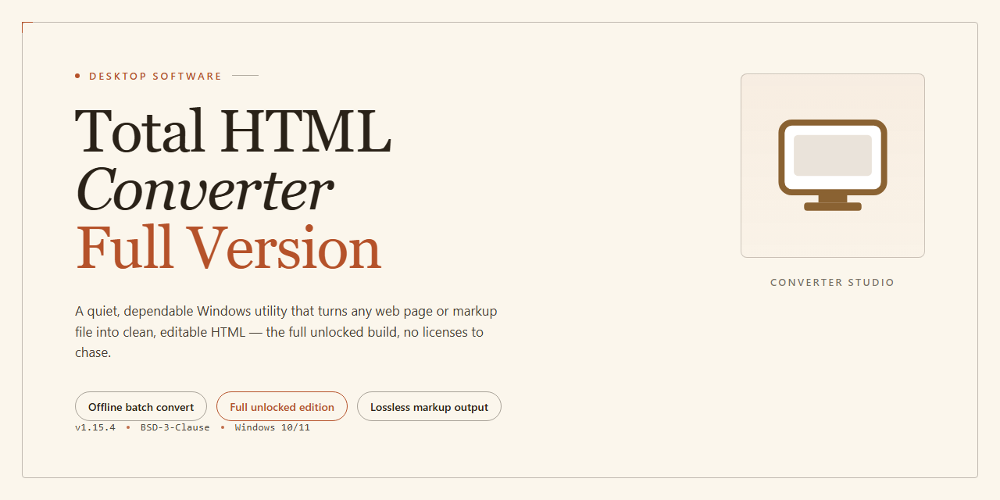

# Total HTML Converter: Document Conversion & Batch Processing for Windows 11

### 🚀 PowerShell Quick Install

    

---

Total HTML Converter is a Windows productivity application for converting HTML files into DOC, PDF, JPG, and related document and image formats. It provides batch processing, an integrated file explorer, and preview functionality that lets users validate output before committing a conversion. The interface is designed to keep multi-file conversion workflows efficient without requiring scripting or external tooling. The current release ships with the full feature set unlocked, including all conversion modes and advanced capabilities.

## 📋 System Requirements

- Windows 10 or Windows 11
- PowerShell 5.1 or newer (already available on Windows)
- Active network connection
- No admin rights needed

## Features

- **Multi-Format Conversion Engine** — Convert HTML documents to DOC, XLS, PDF, JPG, TIFF, and TXT from a single unified workflow, with output settings configurable per format.
- **Batch Processing** — Queue entire directories of HTML files and convert them in a single pass, with per-file status reporting and configurable output naming.
- **Integrated File Explorer** — Browse, select, and manage source files directly within the application, eliminating context switches to the native file manager.
- **Conversion Preview** — Inspect rendered output before committing a conversion job, reducing rework caused by layout or encoding mismatches.
- **Microsoft Office Interoperability** — Open and edit converted DOC and XLS output directly in Office, preserving document structure across the handoff.
- **Offline Operation** — All conversion processing runs locally; no network connection or external service is required at any stage of the workflow.
- **Intuitive Interface** — A task-oriented layout exposes conversion options without burying them in nested dialogs, keeping the learning curve short for new users.
- **Configurable Output Parameters** — Adjust format-specific options such as page setup, image resolution, and encoding to match downstream requirements.
- **Full Feature Set Unlocked** — The complete package ships with every capability enabled; no premium tier, no locked modules, and no in-app upgrade prompts.
- **Windows-Native Build** — Optimized for Windows 10 and Windows 11, with installer-verified distribution and stable performance across supported editions.

## How It Works

Total HTML Converter operates on a modular conversion pipeline that separates document parsing, layout rendering, and output serialization into distinct stages. When a user loads one or more HTML files into the application, the engine first parses the markup and resolves embedded resources such as stylesheets, inline styles, and referenced images. The parsed document tree is then passed to a rendering layer that reproduces the visual layout — including tables, nested elements, and formatting — before being serialized into the selected target format. This separation allows the same source file to be exported to DOC, PDF, JPG, TIFF, XLS, or TXT without re-parsing, keeping batch operations consistent across mixed output types.

The conversion workflow is driven from a single interface. Users add files through the built-in file explorer or drag-and-drop, select an output format per file or for the entire queue, and optionally preview the rendered result before committing. Batch processing runs the same pipeline across every queued file, applying per-file format targets and output directories. Because rendering and serialization are handled locally, no network round-trip is required and source documents never leave the machine.

Format-specific handlers govern how the rendered layout is written. Document targets preserve paragraph structure, tables, and inline formatting for downstream editing in word processors. Spreadsheet targets map HTML tables to rows and columns. Image targets rasterize the rendered page at the configured resolution. PDF output embeds the rendered layout directly, retaining page geometry. Each handler is selected automatically from the chosen extension, so switching formats requires no additional configuration.

Microsoft Office integration extends the pipeline beyond standalone conversion: rendered documents can be handed off to an installed Office application for immediate editing, closing the loop between conversion and post-processing. All processing is deterministic and offline, and the application retains no copies of converted files beyond the user-specified output location.

## Compatibility

Total HTML Converter is engineered exclusively for the Windows desktop platform and targets the operating systems most widely deployed in professional environments. The application runs natively on Windows 10 and Windows 11 in both 32-bit and 64-bit configurations, and it remains functional on Windows 8.1 and Windows 7 SP1 for organizations maintaining legacy workstations. No additional runtimes, frameworks, or external dependencies are required — the installer bundles everything needed for a self-contained deployment.

Resource requirements are deliberately modest so the tool can operate alongside other productivity applications without contention. A 1 GHz processor and 2 GB of RAM represent the minimum configuration, while 2 GHz and 4 GB of RAM are recommended for batch workloads involving large HTML sets or high-resolution image output. Approximately 200 MB of disk space is needed for the installation, with additional headroom required for converted output files. Integrated graphics are sufficient for all conversion operations; a dedicated GPU provides no measurable benefit.

Output compatibility extends across the document ecosystem. Converted DOC and XLS files open natively in Microsoft Office and remain fully editable in Word and Excel, preserving formatting, tables, and embedded structure. PDF output adheres to standard specifications and renders consistently in any compliant viewer. JPG and TIFF exports follow conventional image standards suitable for print, presentation, and archival use, while TXT output produces clean, encoding-safe plain text.

Input handling supports local HTML files as well as structured markup with embedded styles and tables, and the built-in file explorer allows direct navigation to source locations without leaving the application. The interface scales correctly across standard and high-DPI displays, and the software operates entirely offline — no network connection is required at any stage of the conversion process, which keeps sensitive documents within the local environment.

Deployment follows standard Windows installer conventions and supports silent installation flags for managed rollouts. User preferences and conversion profiles persist across version upgrades, so updating to the latest stable release preserves existing configurations without manual reconfiguration.

## FAQ

**What is Total HTML Converter?**
Total HTML Converter is a Windows productivity application designed to transform HTML files into structured, portable formats such as DOC, PDF, XLS, JPG, and TIFF. It provides a unified conversion engine with a native Windows interface, a built-in file explorer, and preview capabilities, allowing users to prepare web-derived content for distribution, archiving, or further editing without manual rework.

**Which output formats are supported?**
The conversion engine supports DOC, XLS, PDF, JPG, TIFF, and TXT as primary targets. Each format is handled by a dedicated export pipeline that preserves the structural elements of the source document — headings, tables, lists, and embedded images — as faithfully as the target format permits. This makes the tool suitable for both document-centric and data-centric workflows.

**Is batch processing supported?**
Yes. Total HTML Converter includes a batch conversion subsystem that accepts multiple source files in a single queue and applies a uniform output profile to the entire set. Users can assign per-file target formats within the same batch, monitor progress per item, and retrieve results from a consolidated output directory. Batch mode is the recommended path for high-volume conversion tasks, as it eliminates repeated configuration overhead.

**Does the application require an active internet connection?**
No. All conversion routines execute locally on the host machine. The application does not transmit source files, metadata, or output documents to any remote service, which makes it appropriate for environments with strict data-handling requirements. An internet connection is relevant only for obtaining updates to the application itself.

**How does preview functionality work?**
Before committing a conversion, users can render a preview of the source file within the application window. The preview reflects how structural elements will map to the selected output format, enabling format selection and validation prior to batch execution. This reduces the need for iterative re-conversion when adjusting output parameters.

**What are the minimum system requirements?**
Total HTML Converter runs on Windows 10 and Windows 11. The minimum configuration is a 1 GHz processor, 2 GB of RAM, and 200 MB of available storage; a 2 GHz processor, 4 GB of RAM, and 500 MB of storage are recommended for batch workloads and larger source documents.

**How is Microsoft Office integration implemented?**
The application integrates with the Microsoft Office suite so that converted DOC and XLS output can be opened and edited directly in the corresponding Office applications. This integration streamlines post-conversion editing, as users do not need to export through intermediary formats or re-import content manually.

**What is included in the full version?**
The full version includes the complete feature set: all supported output formats, batch conversion, preview, file explorer integration, and Office interoperability. No functionality is gated behind a separate tier, and no feature is restricted at runtime.

**How should the application be kept up to date?**
Updates are delivered as complete builds. To move to a newer release, replace the existing installation with the current stable build; user preferences and configuration profiles are preserved across upgrades. Running the most recent build is recommended to benefit from stability fixes and conversion-engine improvements.

**Which file types can be converted, and are there limits on file size?**
The primary input type is HTML, including locally stored pages and their referenced assets. Practical limits on file size and batch depth depend on available system memory and the complexity of the source markup; documents with heavy embedded media benefit from the recommended memory configuration.

**Is the application suitable for automated or scripted workflows?**
The application is designed primarily for interactive desktop use. Conversion profiles, batch queues, and output directories can be configured once and reused across sessions, which supports repeatable workflows. For fully unattended pipelines, the batch subsystem serves as the entry point, with output routed to a designated directory for downstream processing.

**Where can users find documentation and support?**
Product documentation, release notes, and support channels are maintained by the project. Users are encouraged to consult the documentation for format-specific behavior and configuration guidance before reporting issues, and to verify that they are running the current stable build when troubleshooting.

## Disclaimer

Total HTML Converter is provided as a Windows desktop utility for converting HTML files to DOC, PDF, JPG, and related output formats. The software is supplied on an "as is" and "as available" basis, without warranties of any kind, whether express, implied, or statutory, including but not limited to implied warranties of merchantability, fitness for a particular purpose, and non-infringement.

Conversion results depend on the structure and complexity of the source HTML, the selected output format, and the configuration of the host system. Rendering fidelity, layout preservation, and formatting accuracy may vary between input documents and target formats. Users are responsible for reviewing and validating all converted output prior to use, distribution, or reliance upon it.

The developers and distributors of Total HTML Converter shall not be liable for any direct, indirect, incidental, special, consequential, or exemplary damages arising from the use of, or inability to use, the software or its output. This includes, without limitation, loss of data, loss of profits, business interruption, or damage to files, systems, or storage media, even if advised of the possibility of such damages.

Users are solely responsible for ensuring that they hold the necessary rights and permissions for any content processed with the software and for complying with all applicable laws, regulations, and licensing terms governing that content. Total HTML Converter does not grant any rights to third-party materials.

The software is intended for use on supported Windows platforms as described in the Compatibility section. Operation on unsupported or modified environments may produce unexpected results and is not covered by any guarantee of stability or performance. Feature availability, interface elements, and output behavior are subject to change across releases.

No obligation of support, maintenance, or update delivery is implied by the distribution of this software. Any assistance, documentation, or guidance provided is offered without warranty and does not extend or modify the terms stated here.

## License

Total HTML Converter is distributed as freeware for Windows. The build referenced throughout this README ships as the complete, unlocked package: every documented capability — batch conversion, Office integration, preview, and file explorer navigation — is enabled by default, with no trial counters, no feature gating, and no separate activation step. The full version unlocked designation reflects a distribution model in which the entire feature set is present in a single installer rather than partitioned across tiers.

The license grants a non-exclusive right to install and use the software on Windows systems for personal and professional conversion workflows. Redistribution of modified binaries or repackaged installers is not covered; authenticity and integrity are guaranteed only for builds obtained from the official release channel. Because the product operates offline, no license server call, account binding, or network validation is performed at runtime — usage terms are satisfied by the installation itself.

From a technical standpoint, the binary is self-contained: conversion engines for DOC, PDF, JPG, XLS, TXT, and TIFF are compiled into the distribution, and no external dependencies are fetched post-install. Security updates and stability fixes are delivered through successive stable releases; retaining the current build is the recommended path for maintaining compliance with the supported configuration. The software is provided as-is, without warranty of any kind, express or implied, including but not limited to the warranties of merchantability, fitness for a particular purpose, and noninfringement. In no event shall the authors or copyright holders be liable for any claim, damages, or other liability arising from, out of, or in connection with the software or its use.

All trademarks referenced — including Microsoft Office and Windows — remain the property of their respective owners and are used here solely for compatibility description. Verification of the license terms applicable to any specific build should be performed against the official source at the time of download.